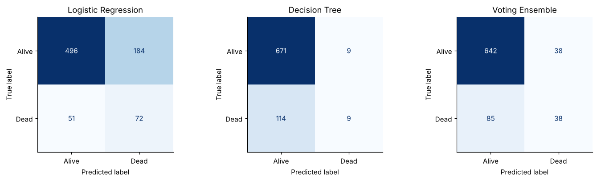
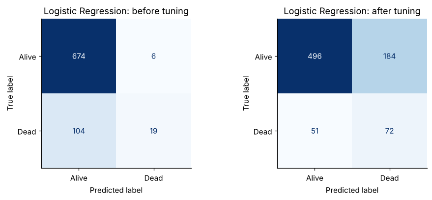
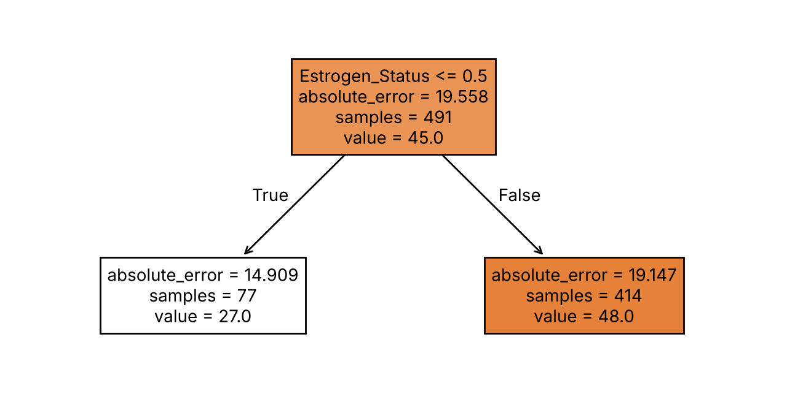

# Breast Cancer Survival Prediction

Machine learning on 4,024 breast cancer patients from the SEER cancer registry. The project looks at whether machine learning has the potential to help doctors predict which patients will survive breast cancer, and for the patients who won't, how many months they will survive.

**Data:** a version of the [SEER Breast Cancer dataset](https://www.kaggle.com/datasets/reihanenamdari/breast-cancer) (US National Cancer Institute), with 18 variables per patient. Details in [data/README.md](data/README.md).

**Built with:** Python, pandas, scikit-learn and matplotlib, in Jupyter notebooks.



## Results

| Question | Best model | Result |
|---|---|---|
| Will the patient die? | Soft voting ensemble (Logistic Regression + Decision Tree) | Half of the patients it predicts as dead really did die (precision 0.50), with an F1-score of 0.38 |
| How many months will they survive? | Multiple Linear Regression | Explains 20% of the variation in survival months (R² 0.20) and is typically around 21 months out (RMSE) |

- Only 15% of the patients died, so a model that predicts everyone is alive would be 85% accurate without finding a single patient who died. This is why I judged the models on precision and F1-score for the dead class instead of accuracy.
- Tuning Logistic Regression raised its F1-score from 0.26 to 0.38 and the share of deaths it found from 15% to 59%, mainly through `class_weight="balanced"`. The trade off was that its precision dropped from 0.76 to 0.28.
- Combining it with a pruned decision tree in a soft voting ensemble brought the precision back up to 0.50 while keeping the same F1-score, so the ensemble makes far fewer false alarms.

## What I did

### 1. Data cleaning and exploration ([Notebook 1](01_data_cleaning.ipynb))

- Decided which variables to retain or drop, with a justification for each one
- Explored the data with descriptive stats, histograms, box plots and an IQR outlier function
- Found and fixed the issues in the data:
  - Mortality status was written 7 different ways (Alive, ALIVE, ALive, alive, Dead, DEAD, dead)
  - A survival time of 760 months, ages of 80 and 89 when everyone else was 30 to 69, negative counts of nodes examined and one patient with 20,003,933 positive nodes
  - A sex column that couldn't be trusted (36% of patients recorded as male, when men are around 1% of breast cancer cases) and an occupation column that was 98% empty
  - Differentiated and Grade holding exactly the same information
- Mapped the stages to numbers in order of severity, and left the missing values to be filled with mean imputation inside the model pipelines, so the test set doesn't leak into training

### 2. Classification ([Notebook 2](02_classification.ipynb))

- 80:20 train-test split, with `stratify` to keep the ratio of alive to dead patients the same and `random_state` so every model is tested on the same patients
- Built Logistic Regression, a Multilayer Perceptron (settings chosen with GridSearchCV) and a Decision Tree (fully grown and pruned), each in a pipeline with mean imputation and scaling
- Evaluated each model with confusion matrices, classification reports and ROC curves, and justified which metrics to use
- Chose Logistic Regression as the best model, then tuned it with GridSearchCV and compared it before and after tuning

Test scores for the dead class:

| Model | Precision | Recall | F1-score | ROC-AUC |
|---|---|---|---|---|
| Logistic Regression | 0.76 | 0.15 | 0.26 | 0.72 |
| MLP | 0.36 | 0.21 | 0.27 | 0.62 |
| Decision Tree (fully grown) | 0.22 | 0.25 | 0.23 | 0.54 |
| Decision Tree (pruned) | 0.50 | 0.07 | 0.13 | 0.68 |
| **Logistic Regression (tuned)** | **0.28** | **0.59** | **0.38** | **0.72** |



### 3. Voting ensemble and regression ([Notebook 3](03_ensembles_and_regression.ipynb))

**Voting ensemble:** I combined the tuned Logistic Regression and the pruned Decision Tree in a soft voting ensemble. They are very different types of model with opposite strengths, so they cover for each other's mistakes.

| Model | Precision | Recall | F1-score | ROC-AUC |
|---|---|---|---|---|
| Logistic Regression (tuned) | 0.28 | 0.59 | 0.38 | 0.72 |
| Decision Tree (pruned) | 0.50 | 0.07 | 0.13 | 0.68 |
| **Voting ensemble** | **0.50** | **0.31** | **0.38** | **0.72** |

**Survival months:** for the 614 patients who died, I built a Multiple Linear Regression (MLR) and a Decision Tree Regressor (DTR), fully grown and tuned with GridSearchCV.

| Model | MAE (months) | RMSE (months) | R² |
|---|---|---|---|
| **MLR** | **17.2** | **21.2** | **0.20** |
| DTR (fully grown) | 26.4 | 31.9 | -0.83 |
| DTR (tuned) | 17.3 | 22.0 | 0.13 |

The tuned tree only splits once, on oestrogen status: oestrogen negative patients are predicted to survive 27 months and oestrogen positive patients 48 months. Notebook 3 also shows step by step how both models predict the survival of a new patient.



## Limitations and ethics

- The dataset is missing a lot of information that affects survival, such as the treatment each patient had, which limits how well any model can do.
- The test set only has 123 patients who died, so the scores could change quite a bit with a different split.
- A model like this should only ever support a doctor's decision, never replace it, as a wrong prediction could mean a patient misses care they need or goes through unnecessary distress.
- The dataset doesn't include ethnicity or income, so I can't check whether the models are fair across different groups of patients.

The full criticism, limitations and ethical issues are at the end of Notebook 2, and the concerns about the regression metrics are in Notebook 3.

## Running it yourself

```bash
git clone https://github.com/Armaank7/breast-cancer-survival-prediction.git
cd breast-cancer-survival-prediction
pip install -r requirements.txt
jupyter notebook
```

The dataset isn't included in this repository. See [data/README.md](data/README.md) for where it comes from and the columns the notebooks expect. Save it as `data/breast_cancer.csv`, then run the notebooks in order (1, 2, 3). Notebook 1 saves the cleaned data and Notebook 2 saves the models that Notebook 3 uses.

Every split and model uses a fixed `random_state`, so running the notebooks again gives the same results. Tested with Python 3.13.

## Project structure

| File | Contents |
|---|---|
| `01_data_cleaning.ipynb` | Retaining and dropping variables, finding and fixing issues, exploring the data |
| `02_classification.ipynb` | Logistic Regression, MLP and Decision Tree, evaluation and tuning |
| `03_ensembles_and_regression.ipynb` | Soft voting ensemble, survival months regression and conclusions |
| `data/README.md` | Where the data comes from and its columns |
| `images/` | Charts used in this README |

**Armaan Khan** | [LinkedIn](https://www.linkedin.com/in/armaan-khan-6a6447189)
